半夜三点刷闲鱼，看到有人在出大疆 T100 植保机拆下来的四目鱼眼视觉模块（配件号 `BC.AG.SS001093`）。这玩意壳子做得挺精致，四颗广角鱼眼围着一圈，屁股后面拖出两根粗黑线，插头是带锁紧耳朵的魔改 Type-C。

第一反应就是：这东西如果收回来，能不能自己摸出线序写个驱动，接到 RK3588 或者 Jetson 上点亮玩玩？

网上搜了一圈，T100 上市时间太新，B 站、YouTube、抖音上能搜到的拆解视频全停留在换外壳、换中框和水泵，没人去撬四目模块的防水胶拍裸板。没办法，只好换路子——去查大疆在美国 FCC 的认证备案。T100（和 FlyCart 100 同平台）对应的 FCC ID 是 **`SS3-T100A2411`**，2025 年 5 月过审，两份 `Internal Photos` 已经公开了。

把里面的板子图翻了一遍，虽然四目模组本身不带无线发射、FCC 没要求拆它，但 T100 整机几块核心板子和外设盒子的高清图全露出来了。顺手整理一份带图笔记，把图上实打实看到的东西、还有顺着线索推出来的判断都记下来，后面真买了实物好对照。

---

## 起因：闲鱼上这颗四目鱼眼，其实藏了两条线索

先看原件长什么样。一个灰色防水圆盖，四周开孔装了四颗鱼眼镜头，侧面同方向引出两根粗屏蔽线，线头是带双螺丝锁紧的多针魔改 Type-C。

<figure>
  <a href="/article-assets/dji-t100-teardown-2026/01-quad-fisheye-exterior.jpg" target="_blank" rel="noopener">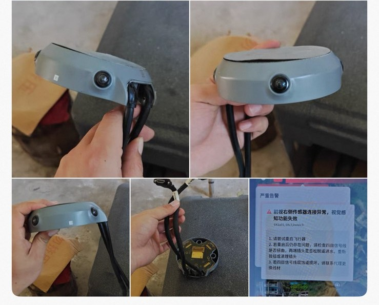</a>
  <figcaption>T100 四目鱼眼（BC.AG.SS001093）外观，右下角是原机报错截图。</figcaption>
</figure>

看这张图别光看壳子，有两个细节特别关键：

1. **线束是对称的两根**：4 颗相机拖出 2 根一模一样粗细的魔改 C 线，大概率就是 1 根线带 2 颗相机。
2. **右下角的报错信息很直白**：App 报的是 `前视右侧传感器连接异常，视觉感知功能失效 0X1a01, 0Xc3, index:3`，排查建议直接写着“检查四目信号线是否扭曲、插头是否松脱或进水”。

这两条合在一起看，意思已经很明显了：飞控/视觉主板是直接按 `index` 管到每一颗 CMOS 传感器的，而且线出问题会单独掉某一路。这不像那种壳子里塞了 Linux 主板、只吐一根网线或 USB 流的智能相机，更像**纯前端传感器模组**（最多加两颗串行器）。另外也能顺便看出闲鱼这个件本身可能坏了一路，拿来当逆向拆解的实验件挺合适，按好件买就得留神了。

---

## FCC 内部照逐块看：T100 肚子里到底装了什么

下面这些图都来自 `SS3-T100A2411` 的公开内部照片。先把每块板子对上号，别把雷达板当成视觉板认错了。

### 1. 19 厘米长的核心航电 / 图传主板

整机最核心的一块长条黑板，标尺量下来快 19 厘米长、4 厘米多宽，元件密度非常高，屏蔽罩已经全掀掉了。

<figure>
  <a href="/article-assets/dji-t100-teardown-2026/02-mainboard-overview.jpg" target="_blank" rel="noopener">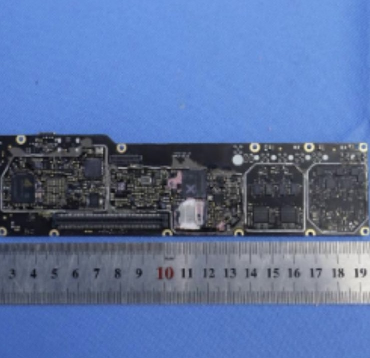</a>
  <figcaption>核心主板正面全貌，底部左侧有一条很长的黑排座。</figcaption>
</figure>

把局部拉近看：右侧两个大屏蔽框里是图传射频收发和前端功放，板子边缘一整排密密麻麻的过孔阵列就是射频馈点；左侧底部有一条大约 5.5 厘米长的高密度 BTB 板对板排座，上面躺着大颗粒存储和电源电路。这种结构在大疆行业机里很常见——核心算力和射频做成一块紧凑的核心板，再通过大 BTB 扣到下面的整机配电/接口载板上。

<figure>
  <a href="/article-assets/dji-t100-teardown-2026/03-mainboard-rf-sdr.jpg" target="_blank" rel="noopener">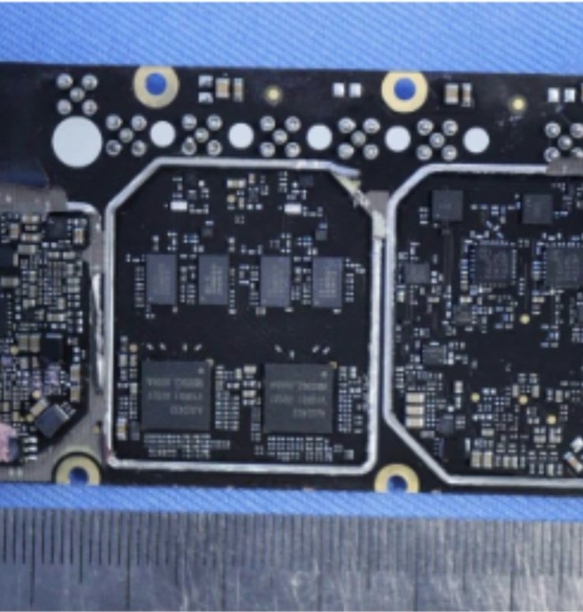</a>
  <figcaption>右侧屏蔽框内的对称双路收发与射频前端，上方一排天线馈点。</figcaption>
</figure>

<figure>
  <a href="/article-assets/dji-t100-teardown-2026/04-mainboard-btb-emmc.jpg" target="_blank" rel="noopener">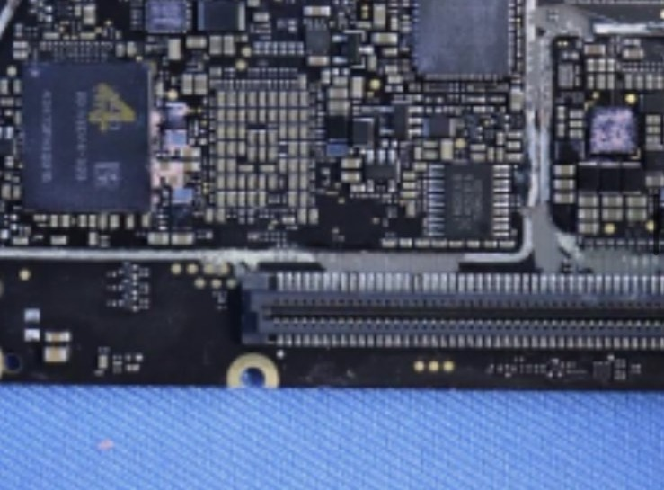</a>
  <figcaption>左侧存储芯片和下面那条超长的高密度 BTB 排座。</figcaption>
</figure>

### 2. 重点中的重点：`V1` 视觉算力核心 + 双 Type-C 口

翻到下面这张图的时候精神了一下——这应该是 T100 的视觉计算核心区。

<figure>
  <a href="/article-assets/dji-t100-teardown-2026/05-mainboard-v1-typec.jpg" target="_blank" rel="noopener">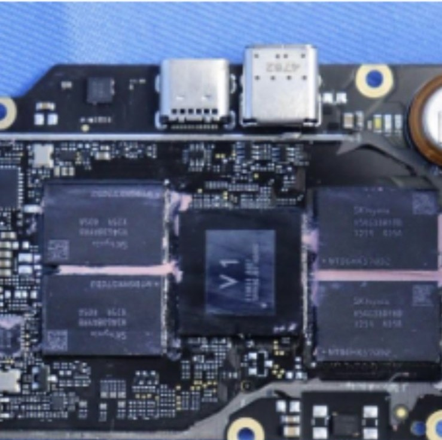</a>
  <figcaption>正中是大疆 V1 视觉芯片，左右四颗海力士 LPDDR4X，正上方并排两个 Type-C 母座。</figcaption>
</figure>

图上直接能读出来的料：

- **正中间裸晶倒装 BGA**：激光打标大大的 **`V1`**，大疆自研的视觉/AI 计算 SoC，负责吃四目/五目视觉和避障感知数据。
- **左右对称四颗内存**：全是 SK Hynix 的 LPDDR4X（丝印 `H54G33BYRB`），四颗配一块视觉主控，带宽堆得挺足。
- **`V1` 正上方板边并排两个 Type-C 母座**：左边壳子短一点，右边壳子长一点、上面印着 `4782`。

盯紧这两个 Type-C 母座和 `V1` 中间那一小条缝：
- **没有大块头的 SerDes 解串芯片**。像车规常用的 `MAX9296A`（7×7mm）、`MAX96712`（8×8mm）或者 TI `DS90UB954`（7×7mm）那种尺寸的芯片，在母座下面根本找不到影子。能看到的只有几颗 2~3mm 级的小 QFN、ESD 保护排阻和耦合电容，差分走线直接穿屏蔽墙进了 `V1`。
- 不过这里得保持克制，不能拍脑袋说这俩口就是四目接口——你看两个母座铁壳明显一长一短，也完全可能一个是标准 USB-C 调参/扩展口，另一个接高速外设，而四目的两根魔改 C 是插在另一块接口载板上的。

### 3. RTK 与无线通信区：国产料占比已经很高了

主板的另外两块射频区也拍得很清楚：

<figure>
  <a href="/article-assets/dji-t100-teardown-2026/06-mainboard-rtk-cxmt.jpg" target="_blank" rel="noopener">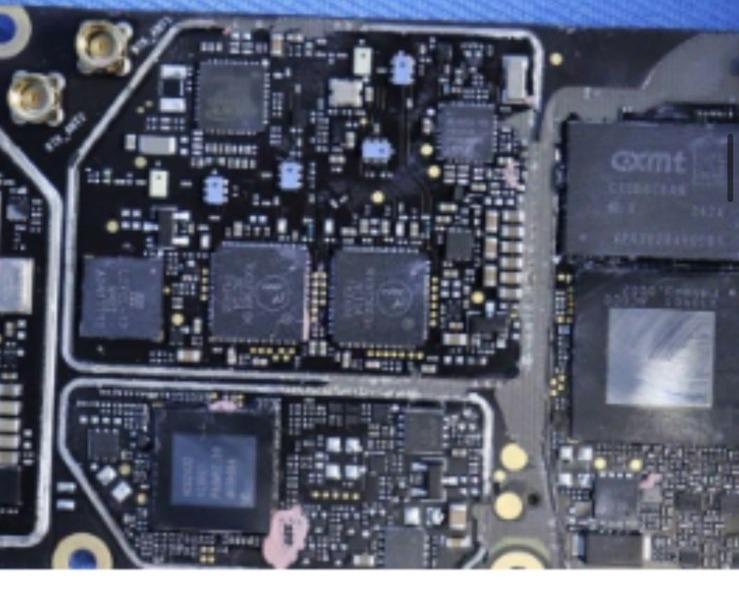</a>
  <figcaption>左上角标注 RTK_ANT1 和 RTK_ANT2，右侧能清晰看到长鑫 CXMT 的内存颗粒。</figcaption>
</figure>

<figure>
  <a href="/article-assets/dji-t100-teardown-2026/07-mainboard-eswin-sdr.jpg" target="_blank" rel="noopener">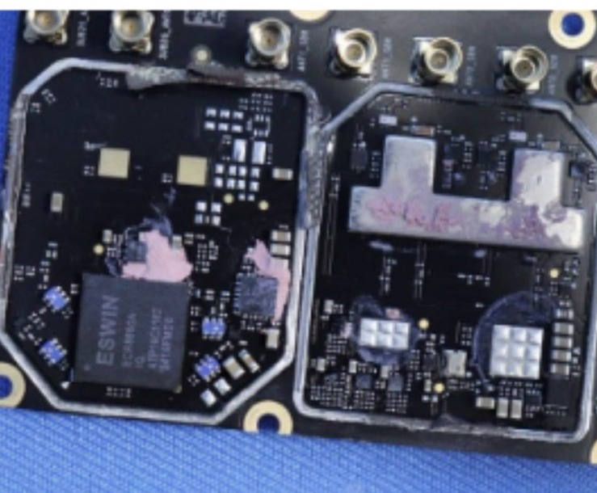</a>
  <figcaption>板边一排 SUB1G 与 ANT0~3_SDR 天线座，左下屏蔽框里是奕斯伟 ESWIN 芯片。</figcaption>
</figure>

几个有意思的料号：
- `RTK_ANT1` / `RTK_ANT2` 进来后接的是两颗一模一样的 GNSS 芯片；
- 旁边那颗大内存印着 **CXMT（长鑫）`CXDB4CBAM`**，2424 批次，下面配着另一颗裸晶主控；
- `SUB1G_ANT` 和 `ANT0_SDR`~`ANT3_SDR` 这侧的屏蔽框里焊着一颗 **ESWIN（奕斯伟）** 的芯片（丝印模糊看着像 `ECRM80A` 这一类），旁边是图传功放。这一代大疆在存储和外围无线芯片上，国产供应链用得已经非常熟了。

### 4. 一块 8×8cm 的独立方板：熟面孔 Xilinx Zynq

档案里还有一块大约 8×8 厘米的方形板子，正反面都拍了，还有芯片放大图。

<figure>
  <a href="/article-assets/dji-t100-teardown-2026/08-zynq-board-front.jpg" target="_blank" rel="noopener">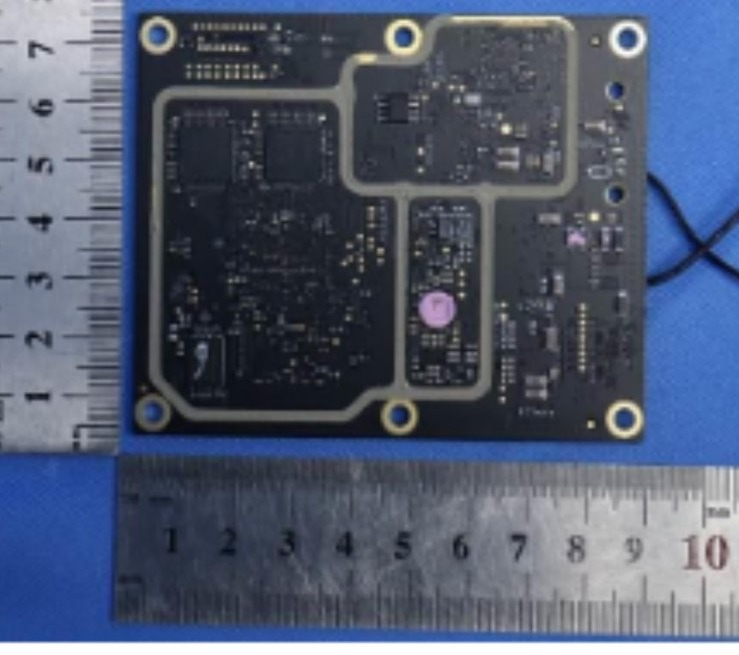</a>
  <figcaption>8×8cm 方形子板正面，大屏蔽框里是两颗对称的方形大芯片。</figcaption>
</figure>

<figure>
  <a href="/article-assets/dji-t100-teardown-2026/09-zynq-board-back.jpg" target="_blank" rel="noopener">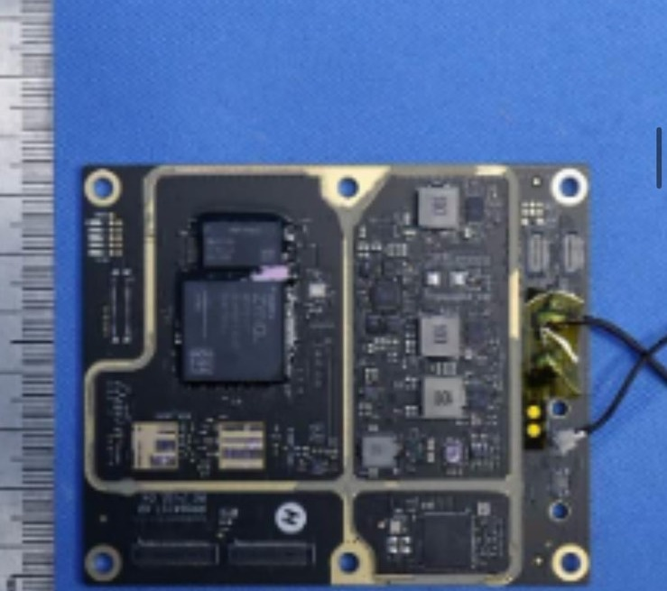</a>
  <figcaption>反面核心是 Xilinx Zynq 加一颗 DDR3，右边三颗 100 电感做电源，底部两个 BTB 排座。</figcaption>
</figure>

<figure>
  <a href="/article-assets/dji-t100-teardown-2026/10-zynq-xc7z020-closeup.jpg" target="_blank" rel="noopener">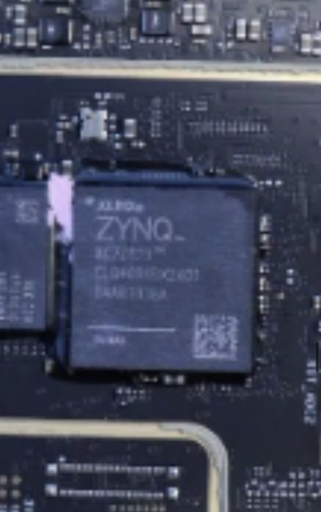</a>
  <figcaption>Zynq 芯片特写：能看清 ZYNQ、CLG400 和 2437 批次码。</figcaption>
</figure>

这颗芯片写 FPGA 的人太眼熟了：**Xilinx Zynq-7000 系列**，封装能看清是 `CLG400`（`XC7Z020` 或 `XC7Z010` 用的都是这个封装，丝印有点糊不敢 100% 咬死是 020 还是 010），批次 `2437`（2024 年第 37 周）。大疆在有源相控阵雷达、激光雷达点云处理和高速信号子板上用 Zynq-7000 用了很多年，这块 8×8cm 的板子明显装不进四目的圆壳，八成是 T100 雷达或者激光雷达的处理板。

### 5. 两个独立防水模组：顺手坐实了“魔改 Type-C”的本体

档案里还拆了两个带防水圈的小盒子，虽然也不是四目，但它们暴露了一个对我特别有用的细节——**T100 外设的 Type-C 母座到底改没改针脚尺寸**。

第一个是直径约 5 厘米的圆形黑板，装在带波浪形防水胶圈的圆座里：

<figure>
  <a href="/article-assets/dji-t100-teardown-2026/11-round-module-housing.jpg" target="_blank" rel="noopener">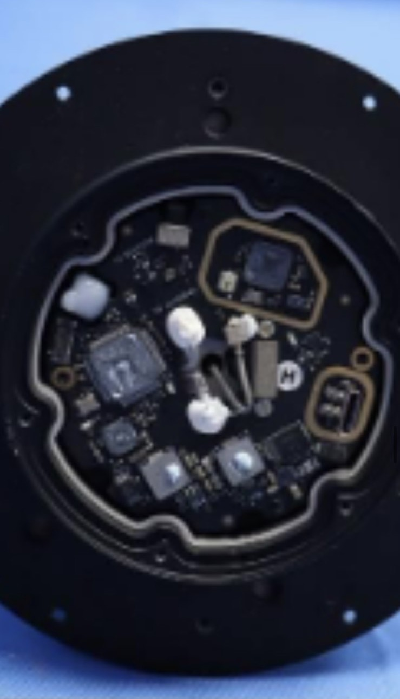</a>
  <figcaption>圆形防水模组内部，中间开孔穿过两根打白胶的 IPEX/U.FL 射频同轴线，右侧是一个 Type-C 母座。</figcaption>
</figure>

<figure>
  <a href="/article-assets/dji-t100-teardown-2026/12-round-module-pcb-front.jpg" target="_blank" rel="noopener">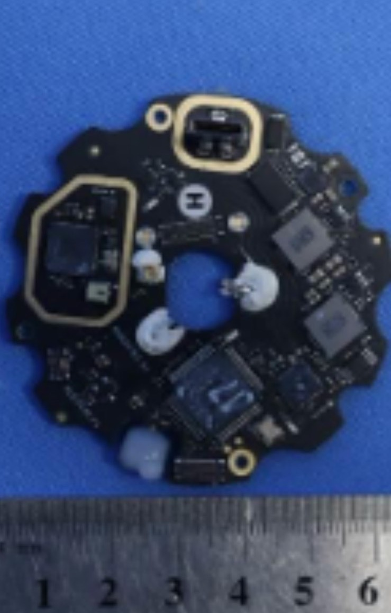</a>
  <figcaption>拆出来的圆形 PCB 正面：顶部包在金色屏蔽圈里的母座，左侧屏蔽射频区，下方 LQFP MCU，右侧两颗降压电感。</figcaption>
</figure>

<figure>
  <a href="/article-assets/dji-t100-teardown-2026/13-round-module-pcb-back.jpg" target="_blank" rel="noopener">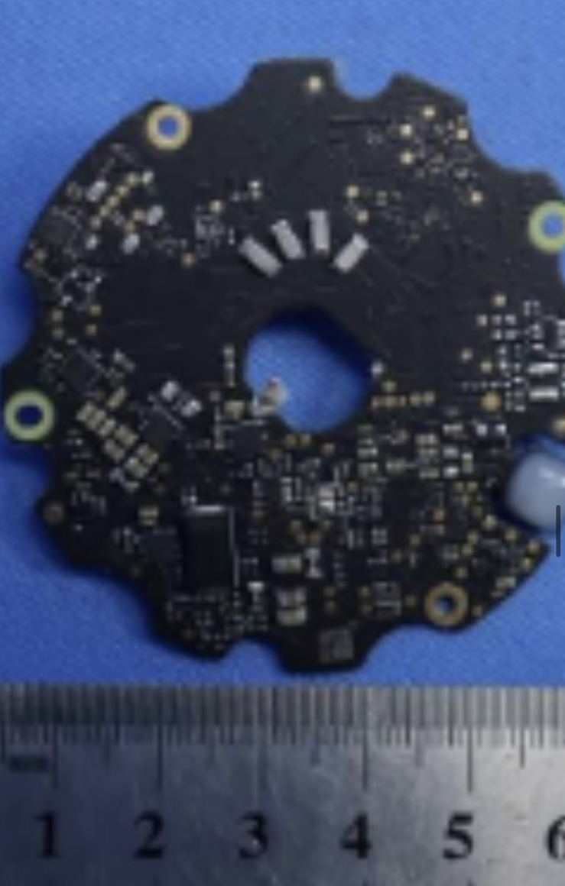</a>
  <figcaption>圆形 PCB 背面。</figcaption>
</figure>

这块圆板中间穿两根射频同轴线，旁边一颗 LQFP MCU 配射频芯片，**只有一个 Type-C 母座**，没有 4 路相机接口，显然是 RTK 天线或者辅助射频/雷达模组，不是四目。

第二个是大约 5.5×5.5 厘米的方形铝合金防水盒，外圈一整条橙红色 O 型密封圈：

<figure>
  <a href="/article-assets/dji-t100-teardown-2026/14-square-module-housing.jpg" target="_blank" rel="noopener">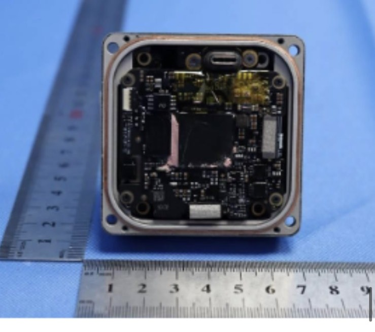</a>
  <figcaption>方形铝合金防水盒，顶部正中也是单个标准尺寸的 Type-C 母座。</figcaption>
</figure>

<figure>
  <a href="/article-assets/dji-t100-teardown-2026/15-square-module-pcb.jpg" target="_blank" rel="noopener">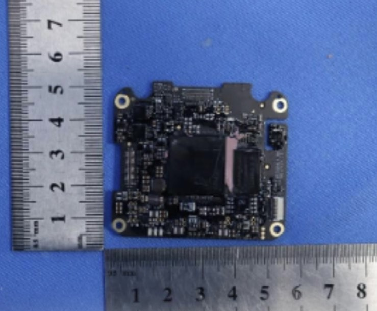</a>
  <figcaption>拆出来的方形 PCB：中间一颗涂满导热硅脂的大 BGA SoC，右边挨着内存/闪存。</figcaption>
</figure>

---

## 线索串起来：对 T100 四目鱼眼的几个硬核推断

FCC 的图翻到这里基本见底了。虽然没直接看到四目壳子里的板子，但把上面所有板子和四目的外观、报错拼在一起，其实已经能推出不少靠谱的结论：

### 推断一：所谓的“魔改 Type-C”，大概率只是改外壳，不用剪线

你看前面连续三个地方——`V1` 主板边上、圆形射频板顶部、方形铝合金盒顶部——全都是**标准尺寸的 Type-C 24-pin 母座**。大疆所谓的“魔改”，主要是外面套了金属屏蔽压圈、防水胶圈和双螺丝锁紧耳朵，防止植保机剧烈震动和农药进水。

这意味着什么？意味着**你不用一上来就剪断原厂那两根高频屏蔽线**。花几块钱买两块 24-pin 全引脚引出的 Type-C 测试母座分线板，最多拿美工刀修掉一点母座外框的防呆凸筋，大概率就能无损把全部 24 根脚引出来测。

> **有一条必须死守**：千万别手痒把这种魔改 C 插头往电脑或手机的 Type-C 口里捅。它是借着 Type-C 的物理壳子走私有线序，VBUS 电压可能不是 5V，高速脚和 CC/SBU 脚下面可能直连 1.8V/1.2V 的 CMOS 引脚，插电脑轻则秒烧传感器，重则把电脑 USB 控制器一起带走。

### 推断二：别的模组全是单线，偏偏四目拖两根——直出 MIPI CSI-2 的概率极高

对比那个 5.5cm 的方形防水盒就能想明白：
- 只要模组里面自己塞了一颗独立 SoC 或 FPGA（像方形盒那样），不管你是做图像压缩、走 USB3 还是走以太网汇聚，**一根 Type-C 线的带宽绰绰有余**，绝不会费劲在防水壳上开两个口、拖两根粗线。
- 偏偏四目鱼眼拖出**两根完全对称的 24 针线**，加上原机报错能直接精确到单个 `index:3`，最顺理成章的架构就是：**四目壳子里没放算力 SoC，4 颗传感器 2+2 分组，每根 24 针线扛两颗传感器的原始信号**。

再帮它算一笔 24 针的账：
- 一根全功能 Type-C 线内部天生带 **4 对高速屏蔽差分线**（`TX1±`、`RX1±`、`TX2±`、`RX2±`）+ `D±` + 4 根辅助线（`CC1/2`、`SBU1/2`）+ 电源和地。
- 闲鱼图里这两根线长度也就二三十厘米，正好落在屏蔽微同轴**直跑 MIPI CSI-2** 的可用距离内。
- 避障鱼眼通常是 100~200 万像素全局快门传感器，每颗走 1-lane（1 对 CLK + 1 对 Data = 2 对差分）或 2-lane（3 对差分），**2 颗相机正好把一根 24 针 Type-C 的高速线吃得干干净净**，剩下的 `CC/SBU` 拿去跑 I2C（SCL/SDA）、MCLK、帧同步（FSYNC）和复位，`VBUS/GND` 走供电。
- 反过来想，如果大疆在四目里放了车规 GMSL2 / FPD-Link 串行芯片，1 根细同轴或者 1 对双绞就能传两路视频加供电，根本没必要浪费 24 针这么宽的头。当然，也不完全排除大疆用双路 STP SerDes 的可能，但直出 MIPI 的嫌疑目前是最大的。

### 推断三：能不能自己写驱动点亮？卡点在哪

公开情报到这就全部榨干了，能不能真的点亮，最后就赌实物拆开后的三件事：

1. **CMOS 传感器是不是通用件**：如果里面是豪威（类似 OV9281 / OV9782 / OX01F 这种全局快门）、思特威或者索尼工业片，能找到同系列公版 datasheet 和寄存器初始化表，那写 Linux V4L2 驱动 + 设备树就不算难；最怕遇到大疆定制磨标片、或者板子里多焊了一颗加密鉴权 MCU（必须和飞控对上暗号才给上电出图），那就得拿真机抓 I2C 包，难度直接翻倍。
2. **到底是直出 MIPI 还是藏了小封装 SerDes**：如果直出 MIPI，画一块很小的 Type-C 转双路 MIPI FPC + LDO 供电板，接 RK3588 或 Jetson Orin 就能直接调；如果是 SerDes，就得按对应芯片配一块解串小板。
3. **24 针线序与供电电压**：这部分反而最容易自己测出来。

---

## 后面如果收了实物，准备按这个顺序摸底

如果决定把闲鱼这个带单路故障的便宜件收回来折腾，按这个顺序动手最不容易烧板子：

1. **先别通电，用 24-pin 测试板扫一遍对地压降**
   插上 24-pin 分线板，万用表打二极管档，红表笔接外壳 GND，黑表笔把 24 个脚挨个点一遍记下来：
   - 对壳 `0Ω` 的全是 GND；
   - 几个脚并联、且表笔碰上去有电容充电跳动的，大概率是供电脚；
   - 重点看标准 `TX1± / RX1± / TX2± / RX2±` 这些成对的高速脚：如果对地压降非常整齐地落在 `0.4V~0.6V`，基本就能实锤**直出 MIPI**（CMOS 芯片内部 ESD 二极管的特征）；如果对地开路（OL），说明线上串了隔直电容，大概率是 **SerDes** 或者 USB3/PCIe。
   - 两根线一对比，顺手就能定位原机报 `index:3` 异常到底是哪几根脚短路或断线了。
2. **拧开外壳看 PCB 丝印**
   重点拍清三类芯片：**CMOS 传感器丝印**、**电源 LDO 丝印**（顺着它查耐压和输出，直接反推出外部该给几伏电，避免一上电就冒烟）、**8 脚 EEPROM（通常是 24Cxx）**——找到 EEPROM 就等于顺藤摸瓜找到了 I2C 总线，而且里面多半还存着大疆出厂标定好的四目内外参，读出来等于白嫖一份高精度标定数据。
3. **先调通 I2C 读 Chip ID，再画转接板出图**
   只要供电给对、接上树莓派/RK3588 的 I2C 能扫出传感器地址并读回 Chip ID，后面接 MIPI 调 V4L2 出图就只是时间问题了。

这篇先记到这，等后面真把实物拆开、测出 24 针线序和芯片丝印了，再接着往后补。
